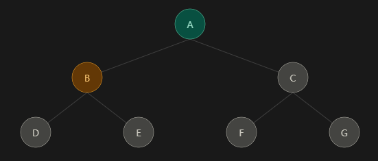
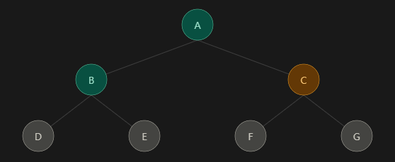
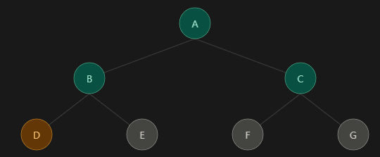
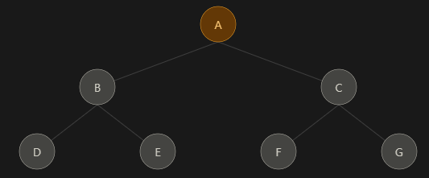
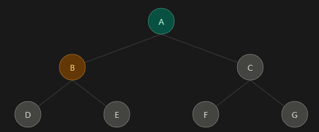
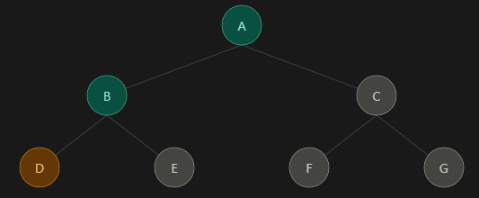
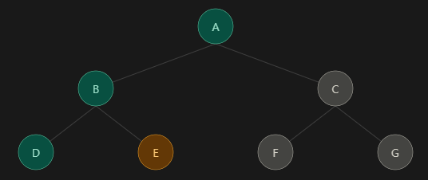
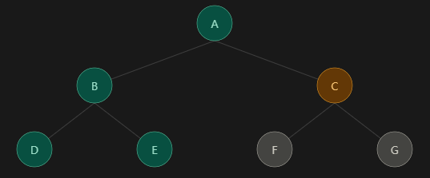


#### <strong># 웹 크롤링이란?</strong>

웹 크롤링(Web Crawling)은 프로그램이 웹 페이지를 자동으로 방문하고, 그 페이지에 있는 링크를 따라 다른 페이지로 이동하면서 웹 문서를 체계적으로 수집하는 과정이다. 이 일을 하는 프로그램을 크롤러(Crawler)라고 부르며, <strong>스파이더(Spider)</strong>, <strong>봇(Bot), 로봇(Robot)</strong>이라고도 한다.

이름에도 의미가 있다. 영어 crawl은 "기어 다니다"라는 뜻이다. 웹(Web)은 원래 거미줄이라는 뜻이고, 그 거미줄 위를 거미처럼 기어 다니며 이곳저곳을 탐색한다는 이미지에서 "스파이더"라는 별명이 생기게 되었다.

웹을 구조적으로 보면, 페이지 하나하나가 점(노드)이고 페이지 사이의 하이퍼링크가 선(간선)인 거대한 그래프이다. 크롤러는 이 그래프를 탐색하는 알고리즘이다. 시작점(Seed URL)에서 출발해 링크를 따라가며 아직 방문하지 않은 페이지를 찾아 나아간다. BFS(너비 우선 탐색), DFS(깊이 우선 탐색)가 실제로 크롤러의 기본 원리이다.

> \[웹 크롤링을 이해하는데 필요한 용어 정리\]  
>   
> 크롤링 : 링크를 따라다니며 페이지를 발견하고 수집하는 과정  
>   
> 스크래핑 : 특정 페이지에서 원하는 데이터만 추출하는 과정  
>   
> 파싱 : HTML 같은 문서를 구조적으로 분석해서 프로그램이 다룰 수 있게 만드는 과정  
>   
> API 호출 : 서비스가 공식적으로 열어준 통로로 데이터를 받는 방식
{: data-ke-style="style3"}

여기서 엄밀히 말하면 검색엔진처럼 넓게 돌아다니는 것을 크롤링, 특정한 정보만을 뽑는 것을 스크래핑이라고 한다.

#### <strong>Seed URL</strong>

<strong>Seed URL</strong>은 크롤러가 처음 방문하는 URL 목록이다. "씨앗"이라는 이름처럼, 여기서 출발해 링크를 따라가며 탐색 범위가 점점 넓어진다.

크롤러는 웹 전체의 주소 목록을 미리 알고 있지 않다. 알고 있는 페이지에서 링크를 발견하고, 그 링크로 이동해서 또 새 링크를 발견하는 방식으로만 웹을 넓혀 갈 수 있다. 그래서 반드시 어딘가에서 출발해야 하고, 그 출발점이 Seed URL이다.

여기서 좋은 Seed는 목표 데이터로 가는 링크가 많이 모여있는 페이지이다.

#### <strong>BFS(너비 우선 탐색, Breadth-First Search)</strong>

<strong>BFS</strong>는 시작점에서 <strong>가까운 페이지부터 차례대로</strong> 방문하는 방식이다. 아래 자료를 예로 들면 A를 방문한 뒤 A와 바로 연결된 B, C를 먼저 모두 방문하고, 그다음 한 단계 더 떨어진 D, E, F, G를 방문한다. 방문 순서는 <strong>A → B → C → D → E → F → G </strong> 이다.

<figure class="imagegridblock">

<figcaption>A → B → C → D → E → F → G</figcaption></figure>

이 방식은 <strong>큐(Queue)</strong>로 구현한다. 큐는 먼저 들어간 것이 먼저 나오는 <strong>FIFO(First In, First Out)</strong> 구조로, 새로 발견한 링크는 줄의 맨 뒤에 서고, 크롤러는 항상 줄의 맨 앞에서 다음 URL을 꺼낸다. 그래서 먼저 발견된(= 시작점에 가까운) 페이지가 먼저 방문된다.

> <strong>장점</strong>
{: data-ke-style="style2"}

<strong>1. 중요한 페이지를 빨리 수집</strong>한다. 이때 메인 페이지에서 가까운 페이지일수록 대체로 중요한 페이지이다.

<strong>2. 깊이 제한을 걸기 쉽다.</strong> "메인에서 3번 클릭 이내의 페이지만 수집" 같은 조건을 자연스럽게 적용할 수 있다.

<strong>3.</strong> 한 갈래에 갇히지 않고 <strong>사이트 전체를 고르게</strong> 훑는다.

> <strong>단점</strong>
{: data-ke-style="style2"}

<strong>1. 메모리를 많이 쓴다.</strong>

한 단계 아래로 내려갈 때마다 발견한 링크가 큐에 쌓이는데, 실제 웹에서는 페이지마다 링크가 수십~수백 개라 큐가 빠르게 커진다.

#### <strong>DFS (깊이 우선 탐색, Depth-First Search)</strong>

<strong>DFS</strong>는 <strong>한 갈래를 끝까지 파고든 뒤</strong> 돌아와서 다른 갈래로 가는 방식이다. 아래 자료를 예로 들면 A에서 B로 내려가고, B에서 D까지 끝까지 내려간다. 더 갈 곳이 없으면 돌아와서 E를 방문하고, B 갈래가 끝나면 C 갈래로 넘어간다. 방문 순서는 <strong>A → B → D → E → C → F → G</strong>입니다.

<figure class="imagegridblock">

</figure>

<figure class="imagegridblock">

<figcaption>A → B → D → E → C → F → G</figcaption></figure>

이 방식은 <strong>스택(Stack)</strong>으로 구현한다(재귀 함수로도 구현 가능). 스택은 나중에 들어간 것이 먼저 나오는 <strong>LIFO(Last In, First Out)</strong> 구조로, 방금 발견한 링크가 맨 위에 쌓이므로 크롤러는 계속 더 깊은 곳으로 들어간다.

> <strong>장점</strong>
{: data-ke-style="style2"}

<strong>1. 메모리 사용량이 상대적</strong>으로 적다.

<strong>2. 특정 경로를 끝까지 따라가야 하는 작업</strong>에 적합하다.

> <strong>단점</strong>
{: data-ke-style="style2"}

<strong>1. 크롤러 함정(Crawler Trap)에 빠지기 쉽다.</strong>

ex) 달력 페이지에 "다음 달" 링크가 있으면 2026년 12월, 2027년 1월, 2027년 2월… 하고 끝없이 새 URL이 만들어진다. DFS는 이런 갈래를 만나면 계속 깊이 들어가기만 해서 다른 중요한 페이지를 영영 수집하지 못할 수 있다. 또 시작점에서 먼, 덜 중요한 페이지에 시간을 많이 쓸 수 있다.

#### <strong># 웹 크롤링 이해하기</strong>

크롤링을 가장 잘 이해하는 방법은 검색엔진의 동작을 보는 것이다. 구글이나 네이버에서 검색하면 결과가 0.몇 초 만에 나온다. 이건 검색하는 순간 웹을 뒤지는 게 아니라, <strong>미리 크롤링해서 정리해 둔 데이터</strong>에서 찾아주기 때문이다.

검색엔진은 크게 네 단계로 작동한다.

<strong>발견(Discovery)</strong>: 이미 알고 있는 페이지의 링크, 사이트맵(sitemap.xml), 사이트 등록 요청 등을 통해 새 URL을 알아낸다.

<strong>크롤링(Crawling)</strong>: 크롤러가 그 URL을 방문해서 페이지 내용을 가져온다. 이때 robots.txt를 먼저 확인한다.

<strong>색인(Indexing)</strong>: 가져온 페이지의 단어, 제목, 이미지, 링크 구조 등을 분석해서 거대한 색인 데이터베이스에 저장한다. 책 뒤의 "찾아보기"를 만드는 것과 비슷하다.

<strong>순위 결정(Ranking)</strong>: 사용자가 검색하면 색인에서 관련 페이지를 찾고, 신뢰도와 관련성 등을 따져 순서를 정해 보여준다.

웹은 매일 바뀌기 때문에 크롤러는 한 번 방문하고 끝나지 않는다. 사이트마다 크롤러가 쓸 수 있는 방문량이 제한되는데, 이를 <strong>크롤 예산(Crawl Budget)</strong>이라고 부릅니다.

#### <strong># 크롤러의 종류</strong>

<strong>범용 크롤러(General-purpose Crawler) :</strong>  주제와 상관없이 웹 전체를 최대한 넓게 수집한다. 구글봇, 네이버의 Yeti 같은 검색엔진 크롤러가 여기에 해당한다.

<strong>집중형 크롤러(Focused Crawler) :</strong>  특정 주제나 특정 사이트만 골라서 수집한다. 예를 들어 "보안 관련 뉴스만", "특정 쇼핑몰의 노트북 카테고리만"처럼 범위를 좁힌다. 개인이나 기업이 만드는 크롤러는 대부분 이 유형이다.

<strong>증분 크롤러(Incremental Crawler) :</strong>  이미 수집한 데이터 중 <strong>바뀐 부분만</strong> 다시 가져온다. 매번 전체를 새로 받는 것보다 효율적이라 가격 모니터링이나 뉴스 수집에 많이 쓰인다.

<strong>딥웹 크롤러(Deep Web Crawler) :</strong> 링크만으로는 닿지 않는 페이지, 예를 들어 검색창에 값을 넣어야만 나오는 결과 페이지를 수집한다.

또 대상 페이지의 성격에 따라 <strong>정적 페이지 크롤링</strong>(서버가 완성된 HTML을 주는 경우)과 <strong>동적 페이지 크롤링</strong>(JavaScript가 실행되어야 내용이 나타나는 경우)으로 나누기도 합니다. 이 구분은 나중에 실습할 때 사용하는 도구를 결정합니다.

#### <strong># 활용</strong>

<strong>웹 취약점 진단</strong>: Burp Suite나 OWASP ZAP 같은 진단 도구는 공격 전에 먼저 크롤링(스파이더링)으로 사이트의 모든 페이지, 파라미터, 입력 폼을 찾아낸다. 이렇게 공격 표면(Attack Surface)을 파악해야 어디를 테스트할지 정할 수 있다.

<strong>위협 인텔리전스</strong>: 해킹 포럼, 다크웹, 코드 저장소 등을 모니터링해서 자사 계정 정보나 소스 코드가 유출됐는지 탐지한다. 예를 들어 GitHub에 실수로 올라간 API 키를 찾아내는 서비스가 이런 원리로 작동한다.

<strong>OSINT(공개 출처 정보 수집)</strong>: 공개된 웹 정보를 모아 위협 정보를 분석한다.

<strong>피싱 사이트 탐지</strong>: 새로 생긴 도메인을 크롤링해서 자사 로그인 페이지를 흉내 낸 사이트를 찾아낸다.

